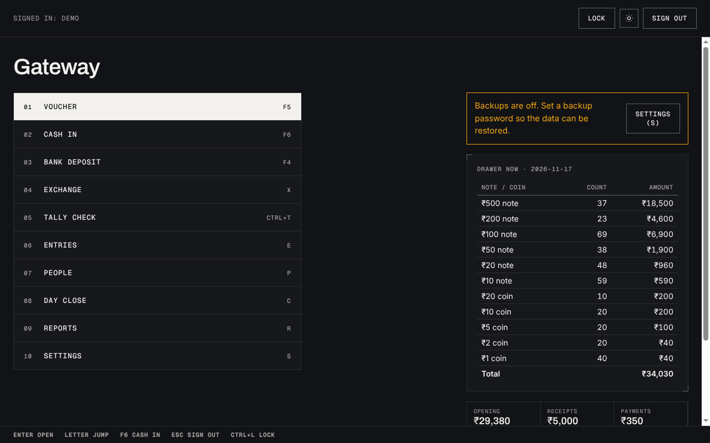
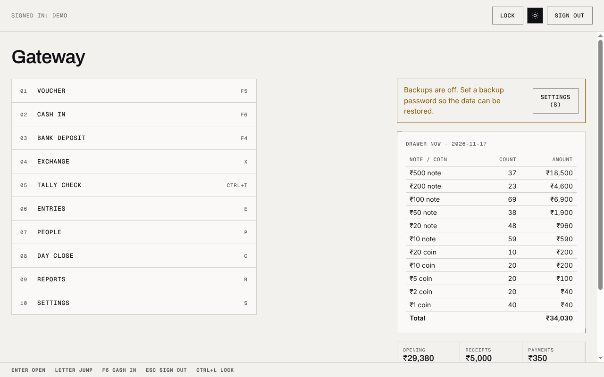
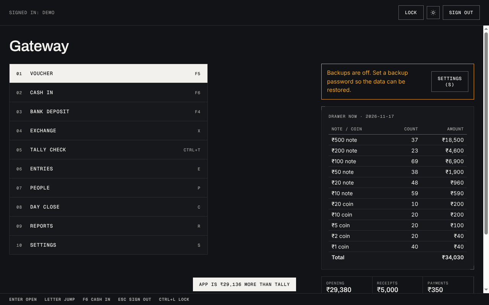
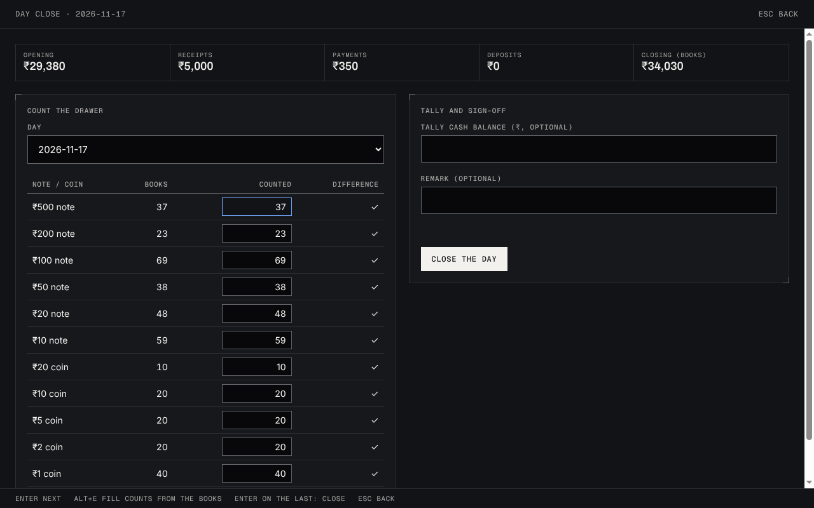
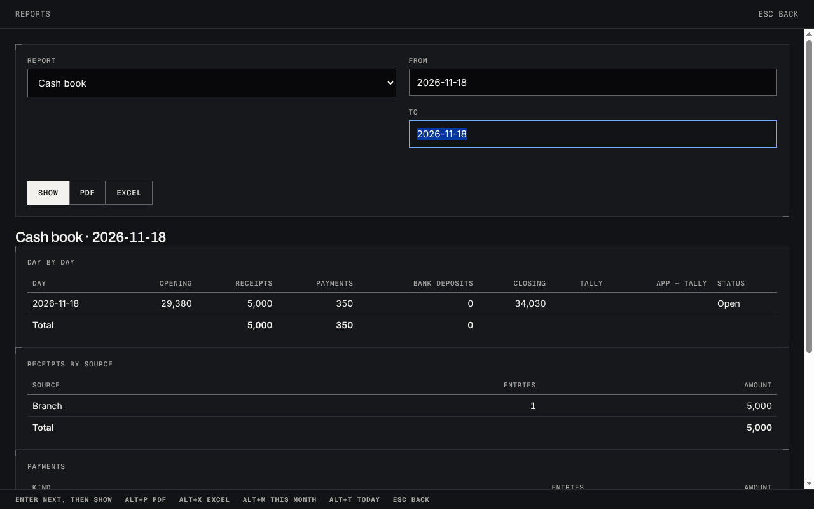
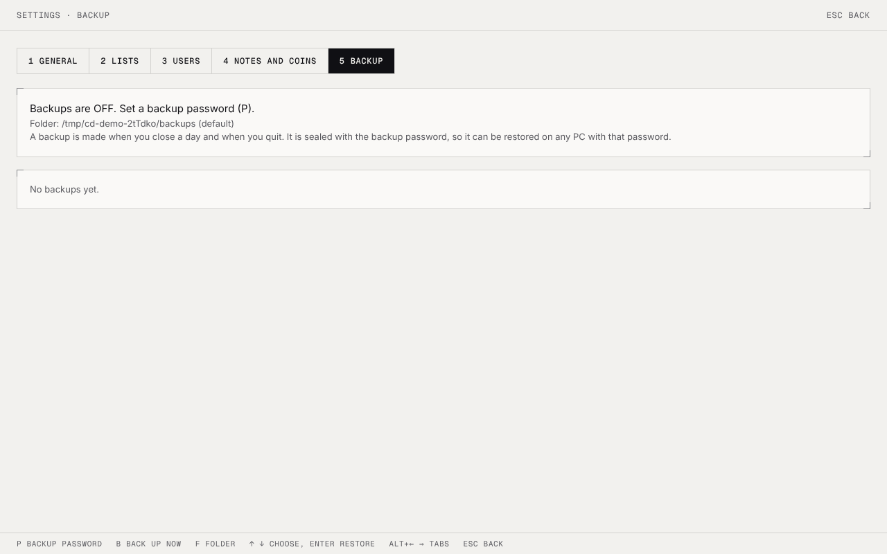

# Cash Desk

A portable Windows app for the head-office cashier. It keeps one cash drawer note by note, pays approved vouchers with a suggested breakup, keeps a running balance for each person, records cash in and bank deposits, checks the cash against Tally, closes the day with a physical count, and prints nine reports. Separate from BOH: its own database and its own login. Everything works from the keyboard, in the style of Tally.

All screenshots below use dummy data (invented names and amounts).

| | |
|---|---|
|  |  |
|  |  |
|  |  |

## What it does

- **Voucher (F5 / V):** find the person, enter the amount, pick one of three rounded payouts (to ₹10; the difference stays as that person's balance), see the notes to give, split into expense lines, confirm.
- **Cash in (F6 / I), Bank deposit (F4 / D), Exchange (X):** every note and coin counted; the drawer and the bank balances move with them.
- **Tally check (T or Ctrl+T) and morning check:** compare the app with Tally at any time; from 9:15 the app asks for yesterday's Tally balance and asks again every 30 minutes until it is entered.
- **Day close (C):** count the drawer, compare with the books and Tally, close. A difference becomes an adjustment so the next day opens on the real count. An admin can reopen a day with a reason.
- **Reports (R):** cash book, denomination report, day entries, voucher register, payments by person, expense summary, receipts by source, bank deposits, person balances. Each as PDF or Excel.
- **Service payment (F):** load the party codes Excel once, then each month's Excel file. Shows what to pay each bank account (Taxable, TDS 2% rounded up, To pay), lists every row that could not be placed, flags the dealer's remarks, matches the bank's UTR file (UTR per bank account, returned payments first), and exports Excel / PDF.
- **Settings (S, admin only):** limits and times, users, hide notes and coins, lists, backups.

## Keys

| Key | Does |
|---|---|
| Enter / Backspace on an empty box | next field / previous field |
| Esc | back (or cancel a box) |
| Letters on the Gateway | jump to that item (V, I, D, X, T, E, P, C, R, F, S) |
| F5, F6, F4 | voucher, cash in, bank deposit |
| Ctrl+T, Ctrl+L | Tally check, lock |
| Alt+P / Alt+X | export the report as PDF / Excel |
| Alt+Left / Alt+Right | change tab in Settings |

## Data and backups

- Data is in `%APPDATA%\Cash Desk`, sealed with AES-256-GCM. The key belongs to the Windows account, so the data folder does not open on another PC.
- Backups are the way to move or recover the data. Set a backup password in Settings, Backup. A backup is made after each day close and when you quit (newest 30 kept, in the data folder's `backups` unless you choose another). A backup restores on any PC with that password. Write the password down: it cannot be recovered.
- Money is whole rupees. The drawer and every balance are added up from the entries, never stored as totals. Nothing is ever deleted: a deleted entry stays in the record marked as deleted.

## Running and building

- `npm start` runs from source (it needs Windows account storage; for tests on other systems see `CASHDESK_TEST_KEYSTORE`).
- `npm test` runs the tests (102).
- `npm run dist:win` builds the portable .exe. GitHub Actions also builds it on every push to main.
- Before a release: bump the version, add a CHANGES.md entry, run `python3 -I scripts-security-csp.py` and the tests.
- `scripts/ui-smoke*.cjs` drive the real app with Playwright; `scripts/demo-shots.cjs` makes the screenshots above.

## Not built

- Editing a saved voucher or entry: delete it and enter it again.
- A manager login. The day-close PDF has Cashier and Manager signature lines instead.

See CHANGES.md for the history.
